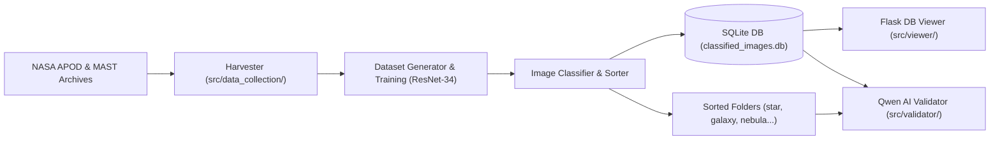
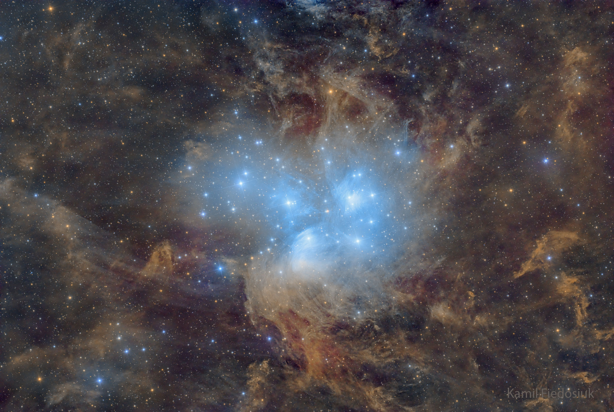
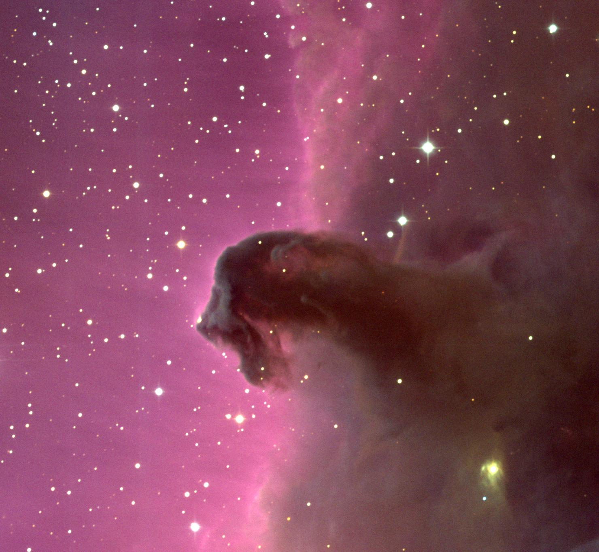
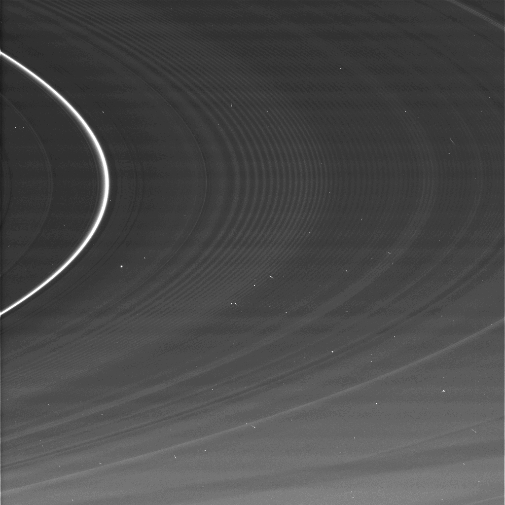
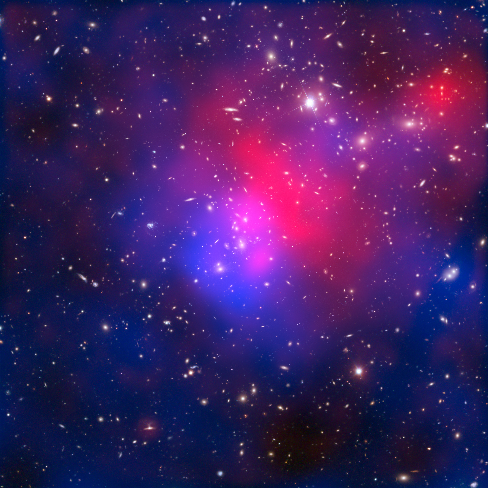

# `nasa-image-training`

<p align="center">
  
</p>

> *"Initializing deep space observation pipeline..."*  
> `[OK] NASA & MAST APIs authenticated.`  
> `[OK] ResNet-34 neural backbone loaded.`  
> `[OK] Local AI validators connected.`  
> `[OK] Ready for observation and validation.`  

<p align="center">
  
  
  
  
  
  
</p>

Welcome to **nasa-image-training**! This repository hosts an end-to-end Deep Learning and Computer Vision pipeline designed to collect, process, train, classify, audit, and visualize astronomical imagery from NASA and the Mikulski Archive for Space Telescopes (MAST). 

Using a custom fine-tuned **ResNet-34** convolutional neural network alongside a local **Qwen 2.5** AI validator (running in-process on your GPU), the system categorizes deep space captures into five astrophysical classes (**stars**, **galaxies**, **quasars**, **nebulae**, and **planets**) and audits each classification in real-time to detect sensor artifacts, cosmic ray hits, and false positives.



<p align="center">
  
</p>

## Target Celestial Categories

The deep space observation model categorizes imagery into five distinct astrophysical classifications:

<table align="center" width="100%">
  <tr>
    <td align="center" width="20%">
      <br>
      <b>Star</b><br>
      <sub>Pleiades Cluster</sub>
    </td>
    <td align="center" width="20%">
      <br>
      <b>Galaxy</b><br>
      <sub>Bode's Galaxy (M81)</sub>
    </td>
    <td align="center" width="20%">
      <br>
      <b>Nebula</b><br>
      <sub>Horsehead Nebula</sub>
    </td>
    <td align="center" width="20%">
      <br>
      <b>Planet</b><br>
      <sub>Saturn Ring Equinox</sub>
    </td>
    <td align="center" width="20%">
      <br>
      <b>Quasar / AGN</b><br>
      <sub>Abell 2744 Core</sub>
    </td>
  </tr>
</table>

| Rail | Target Class | Astronomical Description | Example Targets |
| :---: | :--- | :--- | :--- |
|  | **`star`** | Single stars, stellar fields, globular clusters, open clusters, and star trails. | *Pleiades, Eta Aquaridy, 47 Tucanae, HST UVIS fields* |
|  | **`galaxy`** | Spiral, elliptical, irregular, and merging galaxies or deep galaxy clusters. | *M81, M82, NGC 3628, Hoag's Object, Sombrero* |
|  | **`nebula`** | Emission, reflection, planetary nebulae, supernova remnants, and dark dust clouds. | *Crab Nebula, Horsehead Nebula, Tarantula, Trifid* |
|  | **`planet`** | Solar system planets, planetary moons, ring systems, and planetary surface details. | *Jupiter, Mars, Rhea, Titan Lakes, Cassini views* |
|  | **`quasar`** | Active galactic nuclei, distant energetic pulsars, and high-energy radio sources. | *Vela Pulsar, Abell 2744 Frontier Field* |

<p align="center">
  
</p>

## Model Comparison: 1.2 Flash vs Previous Model

`1.2 Flash` (`training/trained_net.pth`) is a drop-in replacement: same ResNet-34, same five classes. It was trained on ~70,500 images streamed into RAM from SDSS, DECaLS, the NASA Images API, ESA/Hubble and Wikimedia Commons (see [MODEL_CHANGELOG.md](MODEL_CHANGELOG.md)). The previous model is `v1.0` (`trained_net.pth.backup`, 25 epochs on ~5,000 images). The weights file that was in `trained_net.pth` before this release had degraded (near-uniform outputs) and is shown for completeness.

| Metric | **1.2 Flash** (new) | v1.0 (previous) | Degraded `trained_net.pth` (replaced) |
| :--- | :---: | :---: | :---: |
| **Held-out streamed images**, accuracy (n = 4,131) | **93.4%** | 36.7% | 25.6% |
| Held-out streamed images, balanced accuracy | **93.8%** | 45.9% | 22.3% |
| Held-out, curated sources only (NASA/Commons, n = 898) | **97.0%** | 75.1% | 22.3% |
| **Real-world pictures**, accuracy (85 images, 3 independent reviewers each) | **87.1%** (74/85) | 71.8% (61/85) | 38.8% (33/85) |
| Training images | ~70,500 | ~5,000 | ~5,000 |
| Training time / hardware | ~120 min, RTX 4060 Laptop | 25 epochs, Colab T4 | 25 epochs, Colab T4 |
| Inference input / output | 224x224 RGB, 5 classes | identical | identical |

**Per-class results**

| Class | Held-out recall: 1.2 Flash | Held-out recall: v1.0 | Real-world: 1.2 Flash | Real-world: v1.0 |
| :--- | :---: | :---: | :---: | :---: |
| `star` | **90.6%** | 1.6% | 2/6 | 2/6 |
| `galaxy` | **97.2%** | 90.6% | **25/27** | 18/27 |
| `quasar` | **89.9%** | 2.1% | 0/3 | 1/3 |
| `nebula` | **91.7%** | 56.1% | **37/38** | 31/38 |
| `planet` | **99.5%** | 78.9% | 10/11 | 9/11 |

> **How to read this**
> * The held-out set is a 5% split chosen by an image-id hash, never used for training. v1.0 scores low there mainly because it never saw SDSS-style `star` and `quasar` cutouts, so the *real-world* rows are the fairer comparison.
> * Real-world labels come from independent reviewers (not astronomers). `star` (6) and `quasar` (3) have very few samples, so their per-class numbers are noisy. 18 pictures that fit none of the five classes (Moon, meteor showers, landscapes...) were excluded.
> * The `v1.1.0` weights published on Hugging Face were not re-evaluated here, so they are not in the table (their reported 94.2% was measured on a different test set).
> * Known weak spots of 1.2 Flash: globular clusters are often called `galaxy`, real quasars/pulsars/jets are not recognised reliably, and `nebula` has the fewest training images (2,128). Details in the changelog.

<p align="center">
  
</p>

## Architecture & Modules

| Rail | Module | Architecture & Tools | Key Features |
| :---: | :--- | :--- | :--- |
|  | **[Image Harvester](src/data_collection/image_collection.py)**<br><br>   | **Astroquery & Requests**<br>Endpoints: NASA APOD, MAST HST Science Catalog | Automated batch downloader with keyword filtering, fast MJD window queries, deduplication registries, and high-resolution asset acquisition. |
|  | **[Dataset & Model Training](training/network_training.ipynb)**<br><br>    | **ResNet-34 & Matplotlib Analytics**<br>Optimizer: `Adam` (lr=1e-4), Loss: `CrossEntropy` | Custom PyTorch `Dataset` with geometric augmentations (flips, rotations, normalization), AMP acceleration, and automated Matplotlib learning curves & confusion matrix plots. |
|  | **[Classifier & Auto-Sorter](network_sorting/image_classifier.ipynb)**<br><br>  | **Inference Engine & SQLite Logger**<br>DB: `network_sorting/classified_images.db` | Scans raw image directories, runs batch inference, automatically moves files to class-specific folders, and logs full audit metadata to SQLite. |
|  | **[Qwen AI Validator & Trainer](src/validator/qwen_validator.py)**<br><br>   | **Transformers & BitsAndBytes**<br>Model: `Qwen 7B (In-Process)` | Standalone in-process AI validator that audits classifications image-by-image and actively adjusts ResNet-34 neural network weights based on astrophysical evaluations. |
|  | **[Classification Viewer](src/viewer/classification_viewer.py)**<br><br>  | **Flask Lightweight Server**<br>Template: `src/viewer/templates/index.html` | Clean, CSS-free semantic HTML viewer displaying per-category breakdown tables (stars, planets, galaxies, etc.) with record counts and quick jump links. |

<p align="center">
  
</p>

## Pipeline Workflow

<table align="center" width="100%">
  <tr>
    <td width="55px" align="center" valign="top">
      
    </td>
    <td>
      <b>01. Data Harvester</b> (<code>src/data_collection/image_collection.py</code>)<br>
      Downloads high-resolution astronomical targets across NASA APOD and MAST HST archives using keyword matching (<code>galaxy</code>, <code>nebula</code>, <code>planet</code>, <code>cluster</code>, <code>hubble</code>, <code>webb</code>) and JSON progress registries.
    </td>
  </tr>
  <tr>
    <td width="55px" align="center" valign="top">
      
    </td>
    <td>
      <b>02. Deep Learning Training & Matplotlib Analytics</b> (<code>training/</code>)<br>
      ResNet-34 backbone pre-trained on ImageNet with a 5-class linear output head. Augmented with geometric normalization and trained with Automatic Mixed Precision (<code>torch.amp.autocast</code>). Automatically generates loss/accuracy learning curves and confusion matrix heatmaps (<code>plot_training_metrics.ipynb</code>).
    </td>
  </tr>

  <tr>
    <td width="55px" align="center" valign="top">
      
    </td>
    <td>
      <b>03. Automated Sorter & SQLite Logger</b> (<code>network_sorting/</code>)<br>
      Feeds raw imagery through trained weights (<code>trained_net.pth</code>), sorts files into category folders (<code>network_sorting/&lt;predicted_class&gt;/</code>), and logs audit metadata to SQLite (<code>classified_images.db</code>).
    </td>
  </tr>
  <tr>
    <td width="55px" align="center" valign="top">
      
    </td>
    <td>
      <b>04. Qwen AI In-Process Validator & Neural Weight Trainer</b> (<code>src/validator/qwen_validator.py</code>)<br>
      Runs directly inside the Python process using 4-bit GPU quantization (zero external software/daemons required). Audits neural predictions image-by-image, extracts physical/photometric properties, and directly executes backpropagation on ResNet-34 weights (<code>trained_net.pth</code>) based on Qwen's astronomical supervision.
    </td>
  </tr>
  <tr>
    <td width="55px" align="center" valign="top">
      
    </td>
    <td>
      <b>05. Web Classification Viewer</b> (<code>src/viewer/classification_viewer.py</code>)<br>
      Flask application serving a semantic HTML interface without external dependencies, grouping records into tables for stars, planets, galaxies, nebulae, and quasars.
    </td>
  </tr>
</table>

<p align="center">
  
</p>

## Qwen AI In-Process Validator & Neural Trainer Spotlight

The in-process Qwen validator evaluates ResNet-34 classification accuracy and performs online weight updates without requiring external platforms:

```text
NASA DEEP SPACE CLASSIFIER - QWEN AI VALIDATOR & NEURAL TRAINER

Qwen Model:          models--Qwen--Qwen2.5-Coder-7B-Instruct (In-Process, 4-bit CUDA)
Neural Network:      ResNet-34 (trained_net.pth)
Active Weight Edit:  ENABLED (lr=0.0001)
Data Source:         SQLite Database (network_sorting/classified_images.db)
Total to Analyze:    5 images
-------------------------------------------------------------------------------------

[001/005] Image: m109franke2400.jpg
          Neural Net:     galaxy     (P=57.3%) ➔ [✓ CORRECT]
          Qwen Detected:  galaxy     (Confidence: high)
          Explanation:    The image depicts an barred spiral galaxy with prominent arms and bright stellar core.
          ⚡ Qwen Weight Step: Loss 0.557 ➔ 0.281 | Target [galaxy] Prob: 57.3% ➔ 75.5% (+18.2%)

[002/005] Image: retrogrademars03_tezel_big.jpg
          Neural Net:     star       (P=48.2%) ➔ [✗ INCORRECT]
          Qwen Detected:  planet     (Confidence: high)
          Explanation:    Composite sequence showing retrograde motion of Mars against background stars.
          ⚡ Qwen Weight Step: Loss 1.842 ➔ 0.690 | Target [planet] Prob: 15.8% ➔ 50.1% (+34.3%)

FINAL VALIDATION & NEURAL TRAINING SUMMARY

Images Analyzed:           5 / 5
CORRECT Classifications:      3 (60.0%)
INCORRECT Classifications:    2 (40.0%)
Neural Weights Adjusted:   5 gradient updates applied
Average Loss Reduction:    0.4120 per step
-------------------------------------------------------------------------------------
Breakdown by Category:
Category     | Total  | Correct    | Incorrect    | Accuracy  
-----------------------------------------------------------------
galaxy       | 2      | 2          | 0            |   100.0%
planet       | 1      | 0          | 1            |     0.0%
star         | 2      | 1          | 1            |    50.0%
=====================================================================================
```

### CLI Command Options

| Rail | Argument | Description | Example |
| :---: | :--- | :--- | :--- |
|  | `--limit`, `-l` | Maximum number of images to analyze | `python src/validator/qwen_validator.py --limit 10` |
|  | `--category`, `-c` | Filter by category (`star`, `galaxy`, `nebula`, `planet`, `quasar`) | `python src/validator/qwen_validator.py --category galaxy` |
|  | `--lr` | Learning rate for Qwen active weight steps (default: `0.0001`) | `python src/validator/qwen_validator.py --lr 0.0005` |
|  | `--no-weight-updates` | Run in audit-only mode without altering weights | `python src/validator/qwen_validator.py --no-weight-updates` |
|  | `--save-report`, `-o` | Export results and training metrics to JSON report | `python src/validator/qwen_validator.py --save-report report.json` |
|  | `--update-db` | Store audit results in `qwen_validations` SQLite table | `python src/validator/qwen_validator.py --update-db` |
|  | `--image`, `-i` | Audit & train a single standalone image file directly | `python src/validator/qwen_validator.py --image network_sorting/galaxy/m109franke2400.jpg` |

<p align="center">
  
</p>

## Repository Structure

```
NASA_TRAINING/
|-- .env                              # Environment keys (NASA_API_KEY, QWEN_MODEL_PATH)
|-- .env.example                      # Environment template
|-- requirements.txt                  # Python dependencies
|-- README.md                         # Project documentation
|-- readme_assets/                    # SVG banners, dividers, and rail connectors
|   |-- divider.svg
|   `-- rel-*.svg
|-- images/                           # Harvested raw astronomical imagery
|   |-- mastDownloads/                # Hubble Space Telescope products
|   `-- nasaDownloads/                # NASA APOD downloads
|-- training/                         # Model training and dataset generation
|   |-- dataset_generator.ipynb       # Harvester & CSV train/test split builder
|   |-- network_training.ipynb        # ResNet-34 fine-tuning notebook
|   |-- plot_training_metrics.ipynb   # Interactive Matplotlib loss/accuracy & confusion matrix notebook
|   |-- plot_training_metrics.py      # Standalone CLI loss/accuracy & confusion matrix generator
|   |-- cosmos_train.csv              # Training dataset index
|   |-- cosmos_test.csv               # Test dataset index
|   |-- trained_net.pth               # Exported PyTorch ResNet-34 weights
|   `-- huggingface/                  # Hugging Face Hub distribution package
|       |-- README.md                 # Hugging Face Model Card metadata
|       |-- LICENSE                   # CC BY-NC-SA 4.0 license file
|       `-- hugging_face_distributor.py # Model & card publisher script
|-- network_sorting/                  # Batch inference and classified archives
|   |-- image_classifier.ipynb        # Inference & SQLite auto-sorter notebook
|   |-- classified_images.db          # SQLite database tracking sorted files
|   |-- star/                         # Classified star images
|   |-- galaxy/                       # Classified galaxy images
|   |-- nebula/                       # Classified nebula images
|   |-- planet/                       # Classified planet images
|   `-- quasar/                       # Classified quasar images
`-- src/                              # Production source code
    |-- data_collection/
    |   `-- image_collection.py       # Automated APOD & MAST batch collector
    |-- validator/
    |   |-- qwen_validator.py         # Standalone In-Process Qwen AI validator & neural weight trainer
    |   `-- gemini_validator.py       # Transparent compatibility wrapper
    `-- viewer/
        |-- classification_viewer.py  # Flask database web dashboard
        `-- templates/
            `-- index.html            # Semantic HTML category tables view
```

<p align="center">
  
</p>

## Quick Start Guide

###  Step 1: Clone & Prepare Environment

```bash
# Clone the repository
git clone https://github.com/RaulSalasSahuquillo/nasa-image-training.git
cd nasa-image-training

# Create and activate Python virtual environment
python3 -m venv .venv
source .venv/bin/activate

# Install all dependencies
pip install -r requirements.txt
```

###  Step 2: Configure Environment

```bash
# Copy environment template
cp .env.example .env

# (Optional) Customize Qwen model snapshot path in .env if not using default
```

###  Step 3: Harvest Astronomical Images (Optional)

```bash
# Download images from NASA APOD and MAST HST archives
python src/data_collection/image_collection.py
```

###  Step 4: Train Model & Run Classifier

Open and execute the interactive notebooks in Jupyter or VS Code:
* `training/network_training.ipynb` — Train the ResNet-34 model and export `trained_net.pth`.
* `network_sorting/image_classifier.ipynb` — Run inference and populate `classified_images.db`.

For the large-scale streaming fine-tune used by `1.2 Flash` (images go straight to RAM, nothing is saved to disk), run:

```bash
python training/stream_train.py --target 20000
python training/eval_streamed_holdout.py --weights training/trained_net.pth.backup training/trained_net.pth
```

###  Step 5: Audit & Train Neural Network with In-Process Qwen AI

```bash
# Audit classifications and actively update ResNet-34 weights online
python src/validator/qwen_validator.py

# Audit & update first 5 images
python src/validator/qwen_validator.py --limit 5

# Audit specific category and export report
python src/validator/qwen_validator.py --category galaxy --save-report galaxy_audit.json

# Audit in read-only mode without modifying weights
python src/validator/qwen_validator.py --limit 10 --no-weight-updates
```

###  Step 6: Launch Web Classification Viewer

```bash
# Start lightweight Flask classification viewer
python src/viewer/classification_viewer.py
```
Then navigate to **`http://localhost:5000`** in your browser.


<p align="center">
  
</p>

*"In a universe of billions of galaxies, make some code-guided discoveries."*

<p align="center">
  
</p>

## License

This project is licensed under the **Creative Commons Attribution-NonCommercial-ShareAlike 4.0 International** (CC BY-NC-SA 4.0) license.

[](https://creativecommons.org/licenses/by-nc-sa/4.0/)

### Summary of Terms:
* **Attribution:** You must give appropriate credit to **Raúl Salas Sahuquillo** and provide a link to the original repository.
* **Non-Commercial:** You may not use this work, its code, or trained model weights for commercial purposes without explicit written consent.
* **ShareAlike:** If you adapt or build upon this repository, your modifications must be shared under the same license.

<p align="center">
  
</p>

---

<br>

<small>Special thanks to [ShrezesUverse](https://github.com/ShrezesUverse) for providing the .svg files found in readme_assets.</small>