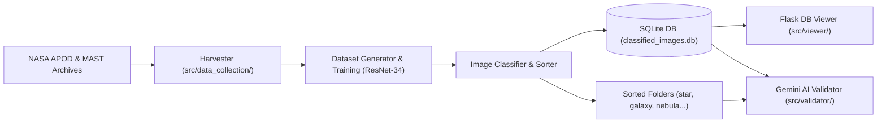
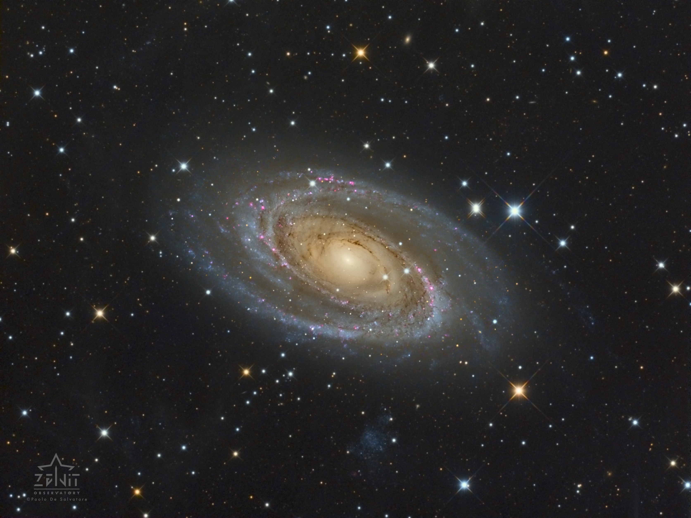

# `nasa-image-training`

<p align="center">
  
</p>

> *"Initializing deep space observation pipeline..."*  
> `[OK] NASA & MAST APIs authenticated.`  
> `[OK] ResNet-34 neural backbone loaded.`  
> `[OK] Gemini 2.5 Flash API multimodal auditor connected.`  
> `[OK] Ready for observation and validation.`  

<p align="center">
  
  
  
  
  
  
</p>

Welcome to **nasa-image-training**! This repository hosts an end-to-end Deep Learning and Computer Vision pipeline designed to collect, process, train, classify, audit, and visualize astronomical imagery from NASA and the Mikulski Archive for Space Telescopes (MAST). 

Using a custom fine-tuned **ResNet-34** convolutional neural network alongside **Google Gemini AI (Multimodal Vision)**, the system categorizes deep space captures into five astrophysical classes (**stars**, **galaxies**, **quasars**, **nebulae**, and **planets**) and audits each classification in real-time to detect sensor artifacts, cosmic ray hits, and false positives.



<p align="center">
  
</p>

## Target Celestial Categories

The deep space observation model categorizes imagery into five distinct astrophysical classifications:

<table align="center" width="100%">
  <tr>
    <td align="center" width="20%">
      <br>
      <b>Star</b><br>
      <sub>Pleiades Cluster</sub>
    </td>
    <td align="center" width="20%">
      <br>
      <b>Galaxy</b><br>
      <sub>Bode's Galaxy (M81)</sub>
    </td>
    <td align="center" width="20%">
      <br>
      <b>Nebula</b><br>
      <sub>Horsehead Nebula</sub>
    </td>
    <td align="center" width="20%">
      <br>
      <b>Planet</b><br>
      <sub>Saturn Ring Equinox</sub>
    </td>
    <td align="center" width="20%">
      <br>
      <b>Quasar / AGN</b><br>
      <sub>Abell 2744 Core</sub>
    </td>
  </tr>
</table>

| Rail | Target Class | Astronomical Description | Example Targets |
| :---: | :--- | :--- | :--- |
|  | **`star`** | Single stars, stellar fields, globular clusters, open clusters, and star trails. | *Pleiades, Eta Aquaridy, 47 Tucanae, HST UVIS fields* |
|  | **`galaxy`** | Spiral, elliptical, irregular, and merging galaxies or deep galaxy clusters. | *M81, M82, NGC 3628, Hoag's Object, Sombrero* |
|  | **`nebula`** | Emission, reflection, planetary nebulae, supernova remnants, and dark dust clouds. | *Crab Nebula, Horsehead Nebula, Tarantula, Trifid* |
|  | **`planet`** | Solar system planets, planetary moons, ring systems, and planetary surface details. | *Jupiter, Mars, Rhea, Titan Lakes, Cassini views* |
|  | **`quasar`** | Active galactic nuclei, distant energetic pulsars, and high-energy radio sources. | *Vela Pulsar, Abell 2744 Frontier Field* |

<p align="center">
  
</p>

## Architecture & Modules

| Rail | Module | Architecture & Tools | Key Features |
| :---: | :--- | :--- | :--- |
|  | **[Image Harvester](src/data_collection/image_collection.py)**<br><br>   | **Astroquery & Requests**<br>Endpoints: NASA APOD, MAST HST Science Catalog | Automated batch downloader with keyword filtering, fast MJD window queries, deduplication registries, and high-resolution asset acquisition. |
|  | **[Dataset & Model Training](training/network_training.ipynb)**<br><br>   | **ResNet-34 Transfer Learning**<br>Optimizer: `Adam` (lr=1e-4), Loss: `CrossEntropy` | Custom PyTorch `Dataset` with geometric augmentations (random flips, 180° rotations, normalization), AMP (`autocast` / `GradScaler`), and test evaluation. |
|  | **[Classifier & Auto-Sorter](network_sorting/image_classifier.ipynb)**<br><br>  | **Inference Engine & SQLite Logger**<br>DB: `network_sorting/classified_images.db` | Scans raw image directories, runs batch inference, automatically moves files to class-specific folders, and logs full audit metadata to SQLite. |
|  | **[Gemini AI Validator](src/validator/gemini_validator.py)**<br><br>  | **Google GenAI SDK**<br>Model: `gemini-2.5-flash` | Automated multimodal auditor that evaluates neural classifications image-by-image, distinguishes CCD noise/cosmic rays from real objects, and prints real-time terminal reports. |
|  | **[Classification Viewer](src/viewer/classification_viewer.py)**<br><br>  | **Flask Lightweight Server**<br>Template: `src/viewer/templates/index.html` | Clean, CSS-free semantic HTML viewer displaying per-category breakdown tables (stars, planets, galaxies, etc.) with record counts and quick jump links. |

<p align="center">
  
</p>

## Pipeline Workflow

<table align="center" width="100%">
  <tr>
    <td width="55px" align="center" valign="top">
      
    </td>
    <td>
      <b>01. Data Harvester</b> (<code>src/data_collection/image_collection.py</code>)<br>
      Downloads high-resolution astronomical targets across NASA APOD and MAST HST archives using keyword matching (<code>galaxy</code>, <code>nebula</code>, <code>planet</code>, <code>cluster</code>, <code>hubble</code>, <code>webb</code>) and JSON progress registries.
    </td>
  </tr>
  <tr>
    <td width="55px" align="center" valign="top">
      
    </td>
    <td>
      <b>02. Deep Learning Training</b> (<code>training/</code>)<br>
      ResNet-34 backbone pre-trained on ImageNet with a 5-class linear output head. Augmented with geometric normalization and trained with Automatic Mixed Precision (<code>torch.amp.autocast</code>).
    </td>
  </tr>
  <tr>
    <td width="55px" align="center" valign="top">
      
    </td>
    <td>
      <b>03. Automated Sorter & SQLite Logger</b> (<code>network_sorting/</code>)<br>
      Feeds raw imagery through trained weights (<code>trained_net.pth</code>), sorts files into category folders (<code>network_sorting/&lt;predicted_class&gt;/</code>), and logs audit metadata to SQLite (<code>classified_images.db</code>).
    </td>
  </tr>
  <tr>
    <td width="55px" align="center" valign="top">
      
    </td>
    <td>
      <b>04. Gemini AI Multimodal Validator</b> (<code>src/validator/gemini_validator.py</code>)<br>
      Audits each neural network prediction one-by-one using Google Gemini 2.5 Flash. Evaluates real morphology: detects whether point sources are true stars or CCD detector noise, dead pixels, and cosmic ray streaks on raw telescope files.
    </td>
  </tr>
  <tr>
    <td width="55px" align="center" valign="top">
      
    </td>
    <td>
      <b>05. Web Classification Viewer</b> (<code>src/viewer/classification_viewer.py</code>)<br>
      Flask application serving a semantic HTML interface without external dependencies, grouping records into tables for stars, planets, galaxies, nebulae, and quasars.
    </td>
  </tr>
</table>

<p align="center">
  
</p>

## Gemini AI Validation Spotlight

The Gemini validator performs deep multimodal reasoning on each image to evaluate ResNet-34 classification accuracy:

```text
NASA DEEP SPACE CLASSIFIER - GEMINI AI VALIDATION

Gemini Model:        gemini-2.5-flash
Data Source:         SQLite Database (network_sorting/classified_images.db)
Total to Analyze:    5 images
Delay Between Calls: 1.0s
--------------------------------------------------------------------------------

[001/005] Image: if7p62ofq_flc.jpg
          Neural Net:     star       [->] Is correct?: [INCORRECT]
          Gemini Detected:digital noise / sensor artifacts (Confidence: high)
          Explanation:    The image depicts raw CCD calibration noise and cosmic ray streaks on black background, not celestial objects.

[002/005] Image: hst_17711_01_acs_sbc_f150lp_jffi01mu_drz.jpg
          Neural Net:     star       [->] Is correct?: [CORRECT]
          Gemini Detected:star (Confidence: high)
          Explanation:    The image displays a dense field of point sources characteristic of a true stellar field with prominent star targets.


FINAL VALIDATION SUMMARY

Images Analyzed:           5 / 5
CORRECT Classifications:   1 (20.0%)
INCORRECT Classifications: 4 (80.0%)
--------------------------------------------------------------------------------
Breakdown by Category:
Category     | Total  | Correct    | Incorrect    | Accuracy  
------------------------------------------------------------
star         | 5      | 1          | 4            |    20.0%
================================================================================
```

### CLI Command Options

| Rail | Argument | Description | Example |
| :---: | :--- | :--- | :--- |
|  | `--limit`, `-l` | Maximum number of images to analyze | `python src/validator/gemini_validator.py --limit 10` |
|  | `--category`, `-c` | Filter by category (`star`, `galaxy`, `nebula`, `planet`, `quasar`) | `python src/validator/gemini_validator.py --category galaxy` |
|  | `--model`, `-m` | Gemini model name (default: `gemini-2.5-flash`) | `python src/validator/gemini_validator.py --model gemini-2.5-flash` |
|  | `--delay`, `-d` | Seconds between requests (default: `1.0s`) | `python src/validator/gemini_validator.py --delay 0.5` |
|  | `--save-report`, `-o` | Export results to a JSON report | `python src/validator/gemini_validator.py --save-report report.json` |
|  | `--update-db` | Store audit results in `gemini_validations` SQLite table | `python src/validator/gemini_validator.py --update-db` |
|  | `--image`, `-i` | Audit a single standalone image file directly | `python src/validator/gemini_validator.py --image network_sorting/nebula/hamster.jpg` |

<p align="center">
  
</p>

## Repository Structure

```
NASA_TRAINING/
|-- .env                              # Environment keys (NASA_API_KEY, GEMINI_API_KEY)
|-- .env.example                      # Environment template
|-- requirements.txt                  # Python dependencies
|-- README.md                         # Project documentation
|-- readme_assets/                    # SVG banners, dividers, and rail connectors
|   |-- divider.svg
|   `-- rel-*.svg
|-- images/                           # Harvested raw astronomical imagery
|   |-- mastDownloads/                # Hubble Space Telescope products
|   `-- nasaDownloads/                # NASA APOD downloads
|-- training/                         # Model training and dataset generation
|   |-- dataset_generator.ipynb       # Harvester & CSV train/test split builder
|   |-- network_training.ipynb        # ResNet-34 fine-tuning notebook
|   |-- cosmos_train.csv              # Training dataset index
|   |-- cosmos_test.csv               # Test dataset index
|   `-- trained_net.pth               # Exported PyTorch ResNet-34 weights
|-- network_sorting/                  # Batch inference and classified archives
|   |-- image_classifier.ipynb        # Inference & SQLite auto-sorter notebook
|   |-- classified_images.db          # SQLite database tracking sorted files
|   |-- star/                         # Classified star images
|   |-- galaxy/                       # Classified galaxy images
|   |-- nebula/                       # Classified nebula images
|   |-- planet/                       # Classified planet images
|   `-- quasar/                       # Classified quasar images
`-- src/                              # Production source code
    |-- data_collection/
    |   `-- image_collection.py       # Automated APOD & MAST batch collector
    |-- validator/
    |   `-- gemini_validator.py       # Google Gemini AI multimodal validator
    `-- viewer/
        |-- classification_viewer.py  # Flask database web dashboard
        `-- templates/
            `-- index.html            # Semantic HTML category tables view
```

<p align="center">
  
</p>

## Quick Start Guide

###  Step 1: Clone & Prepare Environment

```bash
# Clone the repository
git clone https://github.com/RaulSalasSahuquillo/nasa-image-training.git
cd nasa-image-training

# Create and activate Python virtual environment
python3 -m venv .venv
source .venv/bin/activate

# Install all dependencies
pip install -r requirements.txt
```

###  Step 2: Configure API Keys

```bash
# Copy environment template
cp .env.example .env

# Configure Gemini API key securely
printf "Enter GEMINI_API_KEY (typing hidden): " && read -s val && echo && echo "GEMINI_API_KEY=$val" >> ".env" && echo "Saved."
```

###  Step 3: Harvest Astronomical Images (Optional)

```bash
# Download images from NASA APOD and MAST HST archives
python src/data_collection/image_collection.py
```

###  Step 4: Train Model & Run Classifier

Open and execute the interactive notebooks in Jupyter or VS Code:
* `training/network_training.ipynb` — Train the ResNet-34 model and export `trained_net.pth`.
* `network_sorting/image_classifier.ipynb` — Run inference and populate `classified_images.db`.

###  Step 5: Audit Classifications with Gemini AI

```bash
# Validate all classified images
python src/validator/gemini_validator.py

# Test first 5 images with custom delay
python src/validator/gemini_validator.py --limit 5 --delay 1.0

# Audit specific category and export report
python src/validator/gemini_validator.py --category galaxy --save-report galaxy_audit.json
```

###  Step 6: Launch Web Classification Viewer

```bash
# Start lightweight Flask classification viewer
python src/viewer/classification_viewer.py
```
Then navigate to **`http://localhost:5000`** in your browser.


<p align="center">
  
</p>

*"In a universe of billions of galaxies, make some code-guided discoveries."*

<p align="center">
  
</p>

## License

This project is licensed under the **Creative Commons Attribution-NonCommercial-ShareAlike 4.0 International** (CC BY-NC-SA 4.0) license.

[](https://creativecommons.org/licenses/by-nc-sa/4.0/)

### Summary of Terms:
* **Attribution:** You must give appropriate credit to **Raúl Salas Sahuquillo** and provide a link to the original repository.
* **Non-Commercial:** You may not use this work, its code, or trained model weights for commercial purposes without explicit written consent.
* **ShareAlike:** If you adapt or build upon this repository, your modifications must be shared under the same license.

<p align="center">
  
</p>

<small>Special thanks to [ShrezesUverse](https://github.com/ShrezesUverse) for introducing me to the .svg files found in readme_assets, which have made this readme much more visual than it was before.</small>